# Funding Without Concentrated Control?

Studies 01-07: synthetic fan-governance research campaign | 10 November 2026 | 100 presentation trials per condition | Research report

## Abstract and principal findings

The project asks whether a blockchain-supported fan governance system can increase supporter influence and broaden club funding without concentrating control or enabling hostile capture. These experiments test the configured off-chain governance and economic mechanisms. They do not implement or experimentally compare blockchain infrastructure.

All 95 frozen configurations completed: 19 ten-trial pilots and 76 presentation batches. The presentation dataset contains 7,600 trial/cell replications across 76 distinct design cells, six voting models and three matched variants (136,800 trajectory summaries). Each condition/model/variant estimate uses 100 replications from four distinct master seeds. Pilots are excluded from presentation estimates.

| Mechanism | Selected presentation finding (100 trials each) | Research implication |
| --- | --- | --- |
| Wealthy contributor | Proportional, contribution 250,000: 100% [96.3%, 100.0%] -> 0% [0.0%, 3.7%] | Funding rights and political rights require separate design. |
| Fraudulent identities | Equal, 400 aliases, full verification: 100% [96.3%, 100.0%] -> 0% [0.0%, 3.7%] | Equal voting relies on the modeled identity boundary. |
| Genuine hostile entrants | Equal, turnout 0.2 / hostile target 0.3 / wait 180d: 100% [96.3%, 100.0%] | Verification and temporary waiting do not remove genuine hostile voting rights. |
| Organized turnout | Equal, honest 0.2 / hostile 1.0: verification alone 42% [32.8%, 51.8%] -> 42% [32.8%, 51.8%]; full turnout package 42% [32.8%, 51.8%] -> 10% [5.5%, 17.4%] | Participation and identity are different attack surfaces. |
| Economic stress | Equal/defended survival fractions span 100% to 100% across 16 separate economic cells. | A solvent grid does not establish safety outside the tested budget and shock assumptions. |
| Combined-crisis budget artifact | The 100k-contribution attacker spends its full 100k budget and expires for unpaid fees on day 31 in every targeted path. | The zero-capture extension is not evidence of defensive efficacy against a maintained high-contribution attacker. |

Intervals in brackets are pointwise 95% Wilson confidence intervals for the indicated binomial outcome. Arrows compare unprotected with defended conditions; they are not confidence intervals for the paired difference. Full paired contrasts and conservative difference intervals are supplied separately.

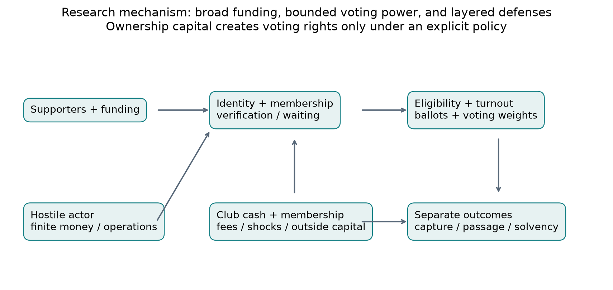

Conceptual diagram of the modeled pathways. Ownership, voting credentials, participation, proposal passage and club cash are distinct mechanisms.

## Methods, design and statistical interpretation

The engine models synthetic supporters, membership identities, wealth/contributions, eligibility, turnout, preferences, six weighting rules, attacker actions and finite budgets, defenses, election dates, and a simplified club ledger. Monetary amounts use arbitrary consistent units. The population is not fitted to any actual club. Lognormal wealth parameters describe the underlying log distribution, not the mean monetary wealth.

| Study | Frozen design | Cells / population / horizon |
| --- | --- | --- |
| 01 | Ordinary / wealth sigma 2 / participation 0.15, crossed with constitutional/funding | 6; 10,000; one month / one election |
| 02 | Wealthy contribution 5k / 50k / 250k; 300k financial budget | 3; 200; 12 months / six-month elections |
| 03 | 50 / 200 / 400 aliases; verification strength 0 / 0.8 / 1 | 9; 200; 12 months / six-month elections |
| 04 | Honest turnout 0.2 / 0.6; hostile target 0.1 / 0.3; wait 0 / 90 / 180 days | 12; 200; 12 months / quarterly elections |
| 05 | Honest turnout 0.2 / 0.6; hostile turnout 0.5 / 1; four defense packages | 16; 200; 12 months / six-month elections |
| 06 | Ten defense packages with 200 attempted aliases | 10; 200; 12 months / quarterly elections |
| 07 | Fee 0 / 30; population 100 / 300; downturn 0.3 / 0.7; offered capital 0 / 30k | 16; 100 / 300; 12 months |
| 07 extension | Revenue loss 0.3 / 0.7; attacker contribution 10k / 100k; downturn fixed 0.5 | 4; 200; 12 months |

The three variants are matched control (no configured attack or economic shock), unprotected (attack/shock under weak identity resolution), and defended (attack/shock plus configured defenses). Control versus defended mixes shocks, attacks and defenses when all are present; defended versus unprotected is the configured defense comparison. Voting models and variants share stochastic inputs within a trial. They are related outcomes, not independent extra replications.

Pilot seed 99001 supplies 10 trials per cell. Presentation batches B01-B04 use seeds 11001-11004 and 25 trials per cell each. Batch-local trial numbers restart at zero. Analysis identifies observations by study group, grid cell, model, variant, master seed and trial. Reexecuting a seed is not extra evidence. Identical completed pilot/B01 runs were reused once. Repeated control/unprotected trajectories across defense policies remain separate references and are never pooled into enlarged sample sizes.

Capture_success is whether the configured attacker objective was reached at any election during the trajectory. Here the objective is a majority of cast voting weight. It is not permanent board control, ownership or a legal takeover. Passed and quorum_achieved in the main condition tables describe the final election; calendar plots use per-election observations. Financial survival means cash never fell below zero in the modeled horizon. Cash/retention summaries are end-of-horizon outcomes.

Binary probabilities are recomputed from raw summaries with pointwise 95% Wilson intervals. With zero events in 100 trials, the interval still extends to approximately 3.7%; zero observed capture does not prove zero risk. Continuous intervals on figures are central 95% trial ranges, not confidence intervals for mean effects. Capture times are conditional on capture occurring and must not be read as uncensored average time to failure.

Paired defense differences use defended minus unprotected for the same cell, model, seed and trial, with discordant and tied trial counts. The supplied binary difference intervals use the conservative distribution-free Hoeffding bound for differences bounded in [-1,1], rather than falsely returning zero-width intervals when all pairs tie. No multiple-comparison adjustment is applied. The report emphasizes mechanisms and effect sizes; it does not declare a universal winner by scanning many conditions for significance.

Named random streams reuse the same master seeds and trial indices across grid cells and study groups as well as across voting models and variants. Consequently, 7,600 trial/cell replications are not 7,600 independent population draws. Uncertainty is estimated within each 100-trial condition; heterogeneous cells are not pooled or counted as independent extra supporters, elections or trials.

All intervals quantify Monte Carlo uncertainty conditional on the frozen parameters and model structure. They do not incorporate uncertainty about empirical calibration, behavioral mechanisms, real security failures or external validity. These are synthetic sensitivity experiments; the campaign is not a preregistered empirical trial.

Condition IDs in derived tables are canonical hashes of all grid parameters after normalizing equivalent integer/float JSON spellings. This prevents an engine label difference such as 1 versus 1.0 from splitting the same scientific condition across batches. source_grid_ids retains every original engine ID; raw files are unchanged. Outside-grid parameters remain separated by study group.

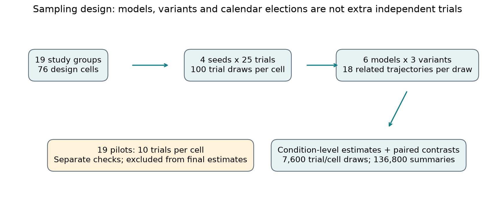

Study design and analysis units. The same trial draw produces matched voting-model and defense outcomes; pilot replications are kept separate.

## Study 01: funding, concentration and supporter representation

This baseline separates the weighting rule from adversarial actions. The three variants are identical references here; only control is used. Potential power refers to eligible weight before turnout. Realized power concerns actual votes cast. A low-turnout profile may leave potential weights unchanged while reducing the effective electorate and increasing realized concentration.

In the wealth-unequal funding condition, proportional voting assigns a mean 38.7% of potential voting power to its most powerful 1% of eligible voters and 2.3% to the bottom half by wealth. Under capped voting, the most powerful 1% hold 1.6%, while the bottom half by wealth hold 28.2%. The most-powerful group can change with the weighting rule and is not defined as the wealthiest 1%. Proportional outcomes differ from equal voting in 43% of these matched trials; this measures disagreement, not decision quality.

| Funding model | Ordinary: most powerful 1% share | Wealth unequal: most powerful 1% share | Wealth unequal: bottom 50% by wealth power | Wealth unequal: outcome differs from equal |
| --- | --- | --- | --- | --- |
| equal | 1% | 1% | 50.0% | 0% [0.0%, 3.7%] |
| proportional | 11% | 39% | 2.3% | 43% [33.7%, 52.8%] |
| capped | 2% | 2% | 28.2% | 9% [4.8%, 16.2%] |
| diminishing | 2% | 2% | 29.9% | 10% [5.5%, 17.4%] |
| hybrid | 2% | 2% | 28.2% | 9% [4.8%, 16.2%] |
| expertise | 2% | 2% | 50.0% | 16% [10.1%, 24.4%] |

The hybrid rule intentionally uses equal voting for constitutional proposals and capped contribution weighting for funding proposals. Its similarity to those rules is a design consequence, not an independently discovered optimal policy. Expertise weighting uses synthetic forecast histories and a reliability calculation; disagreement with equal voting is not evidence of a better decision because no empirical proposal-quality ground truth is available.

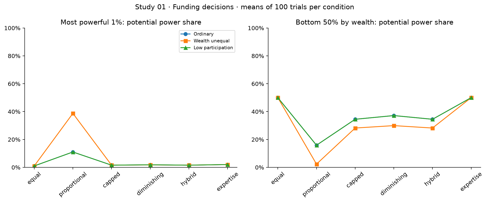

Study 01 funding proposals: mean potential power shares across 100 trials per condition. Baseline control only; constitutional results and all outcome intervals are in condition_results.csv.

## Study 02: wealthy contribution capture

One genuine wealthy supporter contributes a configured lump sum. Strong identity verification alone cannot make a genuine contributor cease to be a distinct voter. The defended package combines identity verification with a weight cap of 5, so these comparisons estimate that package, not verification in isolation.

| Contribution | Voting model | Unprotected capture [95% CI] | Defended capture [95% CI] |
| --- | --- | --- | --- |
| Contribution 5,000 | equal | 0% [0.0%, 3.7%] | 0% [0.0%, 3.7%] |
| Contribution 5,000 | proportional | 0% [0.0%, 3.7%] | 0% [0.0%, 3.7%] |
| Contribution 5,000 | capped | 0% [0.0%, 3.7%] | 0% [0.0%, 3.7%] |
| Contribution 5,000 | diminishing | 0% [0.0%, 3.7%] | 0% [0.0%, 3.7%] |
| Contribution 5,000 | hybrid | 0% [0.0%, 3.7%] | 0% [0.0%, 3.7%] |
| Contribution 5,000 | expertise | 0% [0.0%, 3.7%] | 0% [0.0%, 3.7%] |
| Contribution 50,000 | equal | 0% [0.0%, 3.7%] | 0% [0.0%, 3.7%] |
| Contribution 50,000 | proportional | 99% [94.6%, 99.8%] | 0% [0.0%, 3.7%] |
| Contribution 50,000 | capped | 0% [0.0%, 3.7%] | 0% [0.0%, 3.7%] |
| Contribution 50,000 | diminishing | 0% [0.0%, 3.7%] | 0% [0.0%, 3.7%] |
| Contribution 50,000 | hybrid | 0% [0.0%, 3.7%] | 0% [0.0%, 3.7%] |
| Contribution 50,000 | expertise | 0% [0.0%, 3.7%] | 0% [0.0%, 3.7%] |
| Contribution 250,000 | equal | 0% [0.0%, 3.7%] | 0% [0.0%, 3.7%] |
| Contribution 250,000 | proportional | 100% [96.3%, 100.0%] | 0% [0.0%, 3.7%] |
| Contribution 250,000 | capped | 0% [0.0%, 3.7%] | 0% [0.0%, 3.7%] |
| Contribution 250,000 | diminishing | 0% [0.0%, 3.7%] | 0% [0.0%, 3.7%] |
| Contribution 250,000 | hybrid | 0% [0.0%, 3.7%] | 0% [0.0%, 3.7%] |
| Contribution 250,000 | expertise | 0% [0.0%, 3.7%] | 0% [0.0%, 3.7%] |

The mechanism is the mapping from financial contribution to voting power. Increasing the denominator through more honest funding, changing turnout, or changing the attacker's budget can change these probabilities. A zero result for a bounded rule under this single-person attack does not establish protection against many genuine coordinated members or fraudulent identities.

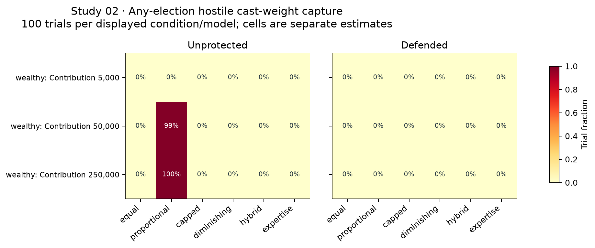

Study 02: fraction of trials with at least one majority-cast capture. The three contribution levels are separate conditions; models are matched within trials.

## Study 03: identity errors and Sybil resistance

This design varies attempted aliases independently of verification strength. Fraudulent aliases differ from genuine hostile people: strong verification can reject aliases without removing genuine hostile membership. The explicit false-acceptance and legitimate-rejection parameters are simulation assumptions, not measured performance of any identity provider.

With 200 attempted aliases under equal voting, defended capture across verification strengths 0 / 0.8 / 1 is 67% [57.3%, 75.4%] / 0% [0.0%, 3.7%] / 0% [0.0%, 3.7%]. Mean accepted fraudulent claims are 100.20 / 21.16 / 0.00, respectively. Full-strength verification has zero fraudulent acceptance by configuration; its synthetic success is not a measured real-world assurance level.

| Verification | Attempted aliases | Equal: unprotected -> defended capture | Defended mean accepted fraudulent claims | Defended legitimate rejection |
| --- | --- | --- | --- | --- |
| 0 | 50 attempted aliases | 0% [0.0%, 3.7%] -> 0% [0.0%, 3.7%] | 25.0 | 1.00% |
| 0 | 200 attempted aliases | 100% [96.3%, 100.0%] -> 67% [57.3%, 75.4%] | 100.2 | 1.00% |
| 0 | 400 attempted aliases | 100% [96.3%, 100.0%] -> 100% [96.3%, 100.0%] | 199.3 | 1.00% |
| 0.8 | 50 attempted aliases | 0% [0.0%, 3.7%] -> 0% [0.0%, 3.7%] | 5.2 | 1.00% |
| 0.8 | 200 attempted aliases | 100% [96.3%, 100.0%] -> 0% [0.0%, 3.7%] | 21.2 | 1.00% |
| 0.8 | 400 attempted aliases | 100% [96.3%, 100.0%] -> 0% [0.0%, 3.7%] | 40.7 | 1.00% |
| 1 | 50 attempted aliases | 0% [0.0%, 3.7%] -> 0% [0.0%, 3.7%] | 0.0 | 1.00% |
| 1 | 200 attempted aliases | 100% [96.3%, 100.0%] -> 0% [0.0%, 3.7%] | 0.0 | 1.00% |
| 1 | 400 attempted aliases | 100% [96.3%, 100.0%] -> 0% [0.0%, 3.7%] | 0.0 | 1.00% |

Counting multiple voting credentials as if they represented distinct verified supporters breaks the premise of equal-member governance. Stake-based rules may appear resistant in this grid because cheap aliases carry little contribution; this does not resolve their wealth-concentration problem in Study 02. Joint governance design must consider both attack surfaces.

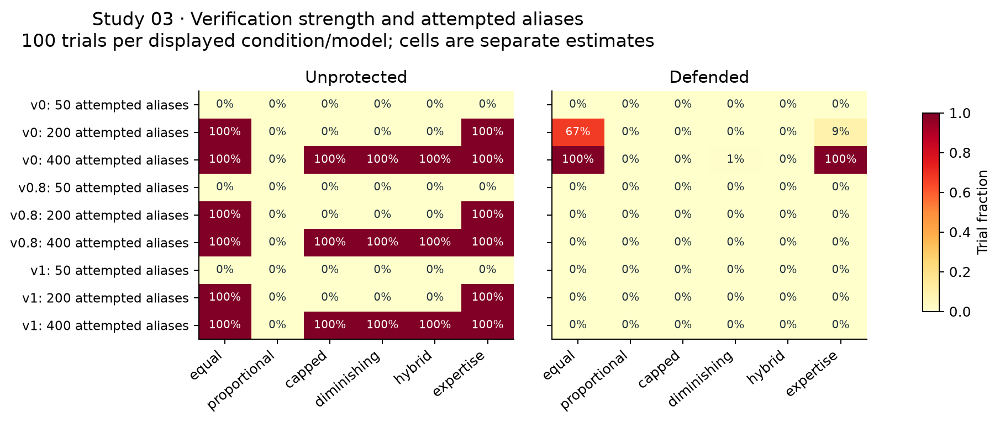

Study 03: capture probability by verification-strength group, alias-attempt count and model. Heatmap percentages are rounded; exact counts/intervals and verification error metrics are in the supplied CSV.

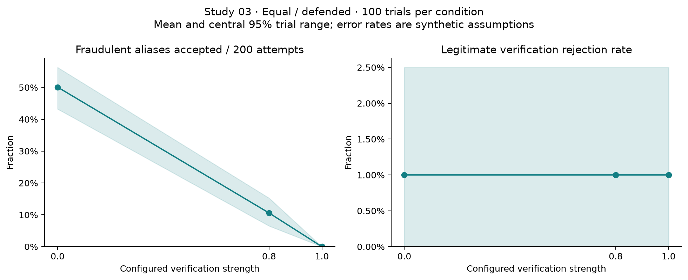

Verification tradeoff with 200 attempted aliases: mean and central 95% trial range for fraudulent acceptance and legitimate rejection. The two panels use different vertical scales. These are configured synthetic errors, not identity-provider measurements.

## Study 04: genuine infiltration and the waiting-period clock

Coordinated entrants are distinct genuine people. Identity verification cannot infer or disqualify a person's policy intentions. A waiting period postpones eligibility; it is not a permanent barrier. Quarterly elections were used specifically to observe the period before and after day-zero entrants become eligible.

With honest turnout 0.2, target hostile share 0.3 and equal voting, defended capture is 100% [96.3%, 100.0%] with no wait and 100% [96.3%, 100.0%] with a 180-day wait. Mean first-capture day among captured trials is 90.0 versus 181.0. The timing difference and annual capture probability answer different questions.

| Turnout / hostile target | Waiting period | Equal defended capture [95% CI] | Mean first capture day among captured trials |
| --- | --- | --- | --- |
| t0.2-h0.1 | Wait 0 days | 0% [0.0%, 3.7%] | not observed |
| t0.2-h0.1 | Wait 90 days | 0% [0.0%, 3.7%] | not observed |
| t0.2-h0.1 | Wait 180 days | 0% [0.0%, 3.7%] | not observed |
| t0.2-h0.3 | Wait 0 days | 100% [96.3%, 100.0%] | 90.0 |
| t0.2-h0.3 | Wait 90 days | 100% [96.3%, 100.0%] | 90.0 |
| t0.2-h0.3 | Wait 180 days | 100% [96.3%, 100.0%] | 181.0 |
| t0.6-h0.1 | Wait 0 days | 0% [0.0%, 3.7%] | not observed |
| t0.6-h0.1 | Wait 90 days | 0% [0.0%, 3.7%] | not observed |
| t0.6-h0.1 | Wait 180 days | 0% [0.0%, 3.7%] | not observed |
| t0.6-h0.3 | Wait 0 days | 0% [0.0%, 3.7%] | not observed |
| t0.6-h0.3 | Wait 90 days | 0% [0.0%, 3.7%] | not observed |
| t0.6-h0.3 | Wait 180 days | 0% [0.0%, 3.7%] | not observed |

Capture measured over the entire year can hide an early protective delay: a later successful capture makes the trajectory count as captured regardless of what happened at the first election. The calendar figure therefore accompanies the any-election summary. Honest turnout and the intended hostile population fraction are separate assumptions; actual membership renewal and eligibility also shape who votes.

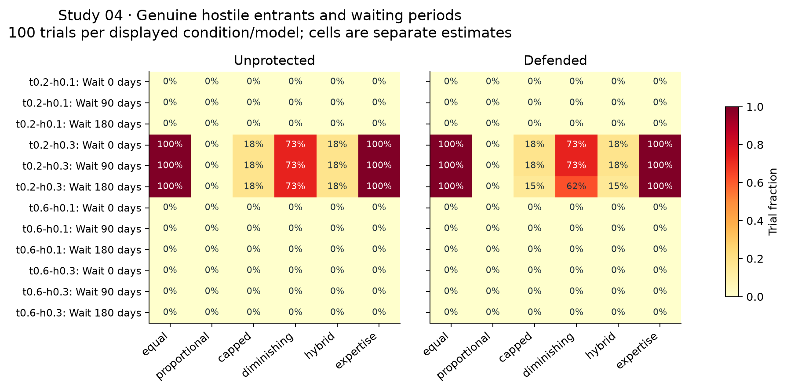

Study 04: any-election capture across the 12 turnout/hostile-share/wait conditions. All six voting models retained.

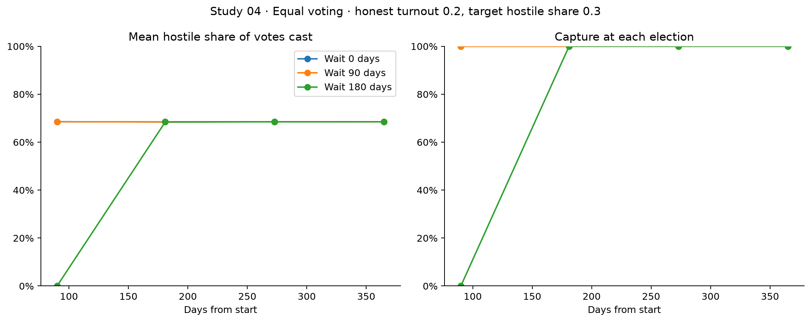

Study 04 calendar view: equal voting, honest turnout 0.2, target hostile share 0.3. Each point is a separate election over the same 100 trial trajectories; time points are not independent replications.

## Study 05: organized minorities, incentives and quorum

The attack recruits 15% of existing supporters and varies coordinated hostile turnout against honest turnout. Verification cannot distinguish hostile preferences among legitimate existing voters. The four defense packages isolate verification, the addition of quorum, the addition of a participation incentive, and their combination.

For equal voting with honest turnout 0.2 and hostile turnout 1.0, defended capture across verification / verification+quorum / verification+incentive / all three is 42% / 42% / 5% / 10%. Final-election proposal passage across those same packages is 100% / 0% / 100% / 79%. These should not be collapsed into one generic success rate.

The combined package need not rank best on every sampled outcome. Matching seeds preserves shared population and base behavioral draws, but composing policies can use different intervention random streams; these are full-package comparisons, not a guarantee of identical incentive responses under every policy ordering. Interpret 100-trial differences alongside their uncertainty rather than selecting a winner from small percentage gaps.

| Package: honest 0.2 / hostile 1.0 | Equal capture [95% CI] | Proportional capture [95% CI] | Equal final passage [95% CI] | Equal final quorum [95% CI] |
| --- | --- | --- | --- | --- |
| Verify 1 | 42% [32.8%, 51.8%] | 54% [44.3%, 63.4%] | 100% [96.3%, 100.0%] | 100% [96.3%, 100.0%] |
| Verify 1 + Quorum 0.4 | 42% [32.8%, 51.8%] | 54% [44.3%, 63.4%] | 0% [0.0%, 3.7%] | 0% [0.0%, 3.7%] |
| Verify 1 + Incentive 0.2 | 5% [2.2%, 11.2%] | 18% [11.7%, 26.7%] | 100% [96.3%, 100.0%] | 100% [96.3%, 100.0%] |
| Verify 1 + Quorum 0.4 + Incentive 0.2 | 10% [5.5%, 17.4%] | 14% [8.5%, 22.1%] | 79% [70.0%, 85.8%] | 79% [70.0%, 85.8%] |

A quorum constrains whether a decision can pass, while capture measures hostile cast-weight dominance. Those outcomes can diverge. Incentives increase turnout under an assumed response function and impose configured administrative costs; the simulations do not establish that real supporters would respond at the specified rate. Compare the capture, passage and quorum panels rather than describing all blocked decisions as prevented capture.

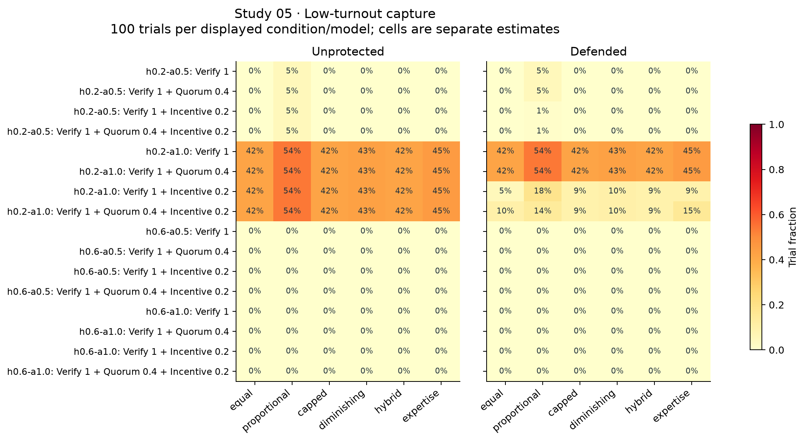

Study 05: any-election cast-weight capture. h denotes honest turnout; a denotes hostile turnout. Each package is a distinct matched cell.

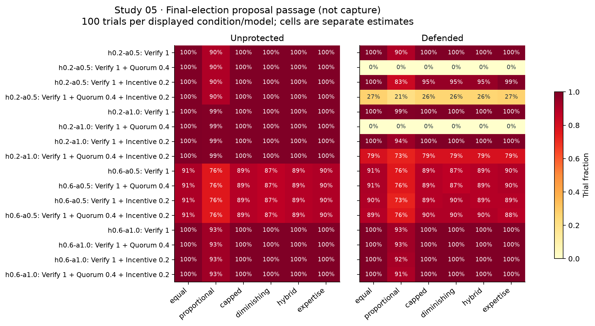

Study 05: final-election proposal passage. Passage may occur without hostile majority capture because honest voters may also approve the proposal.

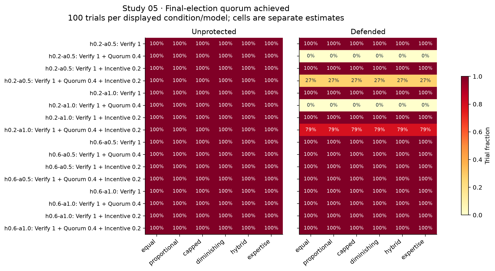

Study 05: final-election quorum achievement, separate from both approval and capture.

## Study 06: ten defense packages and their costs

This study compares ten original policy packages under a 200-alias attempt. The packages span waiting, caps, quorum, incentives, suspicious-activity restriction, weak/strong verification, verification plus waiting, verification plus manual review, and a combined package. Administrative costs and legitimate restrictions are part of the comparison; effectiveness alone is insufficient.

| Package | Equal defended capture [95% CI] | Mean defense admin cost | Mean fraudulent claims accepted | Mean legitimate supporters restricted |
| --- | --- | --- | --- | --- |
| Wait 180d | 100% [96.3%, 100.0%] | 0.0 | 200.0 | 0.00 |
| Cap 3 | 100% [96.3%, 100.0%] | 0.0 | 200.0 | 0.00 |
| Quorum 0.5 | 100% [96.3%, 100.0%] | 0.0 | 200.0 | 0.00 |
| Incentive 0.4 | 100% [96.3%, 100.0%] | 260.0 | 200.0 | 0.00 |
| temporary_restriction | 100% [96.3%, 100.0%] | 0.0 | 200.0 | 0.00 |
| Verify 0 | 100% [96.3%, 100.0%] | 0.0 | 200.0 | 0.00 |
| Verify 1 | 0% [0.0%, 3.7%] | 0.0 | 0.0 | 0.00 |
| Verify 1 + Wait 180d | 0% [0.0%, 3.7%] | 0.0 | 0.0 | 0.00 |
| Verify 1 + manual_review | 0% [0.0%, 3.7%] | 0.0 | 0.0 | 0.00 |
| Verify 1 + Cap 3 + Quorum 0.3 + Incentive 0.2 | 0% [0.0%, 3.7%] | 0.0 | 0.0 | 0.00 |

Waiting and quorum act on eligibility timing and decision validity; they do not perform identity resolution. A per-account cap cannot by itself merge fraudulent aliases. Monitoring/manual review is distinct from restricting voting, and restrictions require the configured review safeguards. A same-named verification strength across Studies 03 and 06 does not imply identical false-acceptance assumptions; compare full policy parameters before attributing cross-study differences to a single mechanism.

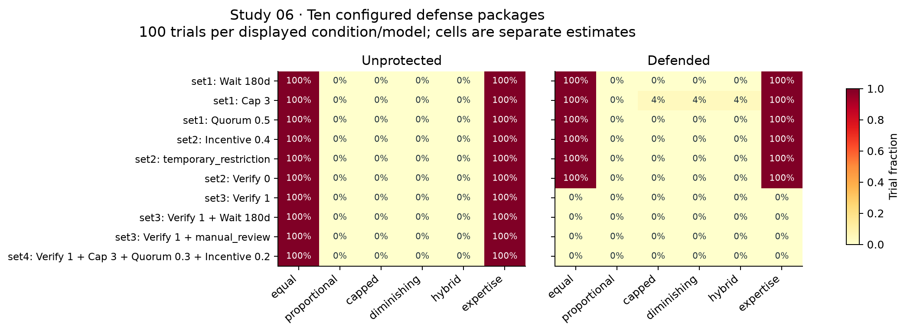

Study 06: any-election capture for every package and voting rule. Repeated unprotected references across packages are not pooled into a larger independent sample.

## Study 07: fees, economic shocks and outside capital

The 16 cells vary population, membership fees, downturn severity and an offered outside-capital investment without voting rights. The capital offer is not guaranteed funding: shock-dependent willingness may cause the investor to decline. Ownership share and voting rights are explicitly separate. Equal/defended trajectories are used for the financial figures to avoid treating six copies of bookkeeping outcomes as independent data.

Mean final cash across the 16 equal/defended cells ranges from 35,495 (N=300; fee=0; downturn=0.7; capital=0) to 186,515 (N=300; fee=30; downturn=0.3; capital=30k). These extrema compare different explicit budgets, fees, shocks and capital offers; they are not a pooled treatment effect.

For N=100 with no membership fee, the 30,000 capital offer is actually received in 73% [63.6%, 80.7%] under downturn severity 0.3 and 32% [23.7%, 41.7%] under severity 0.7. The difference reflects the model's stress-dependent investment willingness; a financing offer is not the same as cash in the bank.

| Condition (capital is offered) | Mean final cash | Survived [95% CI] | Capital received [95% CI] | Mean retention |
| --- | --- | --- | --- | --- |
| N=100; fee=0; downturn=0.3; capital=0 | 55,831 | 100% [96.3%, 100.0%] | 0% [0.0%, 3.7%] | 94.9% |
| N=300; fee=0; downturn=0.3; capital=0 | 55,589 | 100% [96.3%, 100.0%] | 0% [0.0%, 3.7%] | 94.9% |
| N=100; fee=0; downturn=0.7; capital=0 | 35,737 | 100% [96.3%, 100.0%] | 0% [0.0%, 3.7%] | 94.9% |
| N=300; fee=0; downturn=0.7; capital=0 | 35,495 | 100% [96.3%, 100.0%] | 0% [0.0%, 3.7%] | 94.9% |
| N=100; fee=30; downturn=0.3; capital=0 | 92,174 | 100% [96.3%, 100.0%] | 0% [0.0%, 3.7%] | 94.9% |
| N=300; fee=30; downturn=0.3; capital=0 | 164,615 | 100% [96.3%, 100.0%] | 0% [0.0%, 3.7%] | 94.9% |
| N=100; fee=30; downturn=0.7; capital=0 | 72,080 | 100% [96.3%, 100.0%] | 0% [0.0%, 3.7%] | 94.9% |
| N=300; fee=30; downturn=0.7; capital=0 | 144,522 | 100% [96.3%, 100.0%] | 0% [0.0%, 3.7%] | 94.9% |
| N=100; fee=0; downturn=0.3; capital=30k | 77,731 | 100% [96.3%, 100.0%] | 73% [63.6%, 80.7%] | 94.9% |
| N=300; fee=0; downturn=0.3; capital=30k | 77,489 | 100% [96.3%, 100.0%] | 73% [63.6%, 80.7%] | 94.9% |
| N=100; fee=0; downturn=0.7; capital=30k | 45,337 | 100% [96.3%, 100.0%] | 32% [23.7%, 41.7%] | 94.9% |
| N=300; fee=0; downturn=0.7; capital=30k | 45,095 | 100% [96.3%, 100.0%] | 32% [23.7%, 41.7%] | 94.9% |
| N=100; fee=30; downturn=0.3; capital=30k | 114,074 | 100% [96.3%, 100.0%] | 73% [63.6%, 80.7%] | 94.9% |
| N=300; fee=30; downturn=0.3; capital=30k | 186,515 | 100% [96.3%, 100.0%] | 73% [63.6%, 80.7%] | 94.9% |
| N=100; fee=30; downturn=0.7; capital=30k | 81,680 | 100% [96.3%, 100.0%] | 32% [23.7%, 41.7%] | 94.9% |
| N=300; fee=30; downturn=0.7; capital=30k | 154,122 | 100% [96.3%, 100.0%] | 32% [23.7%, 41.7%] | 94.9% |

Cash follows starting cash plus operating surplus, financing and investment cash flows. Outside funding can raise cash without changing voting rights; this is a mechanism already built into the offered policy, not evidence that any real investor would accept those terms. Membership fees improve revenue only while people remain willing and able to pay. Here population changes are not paired with a per-capita rescaling of club costs, so these cells should not be interpreted as a pure scale experiment.

Across the equal/defended economic cells, observed survival spans 100%-100%. If no insolvency occurs in a cell, its zero-failure interval still permits failures outside the sampled trials. The tested buffers, revenues and shock horizon do not identify a universal solvency threshold. Null runway means no current cash burn under the engine definition; it is not zero runway.

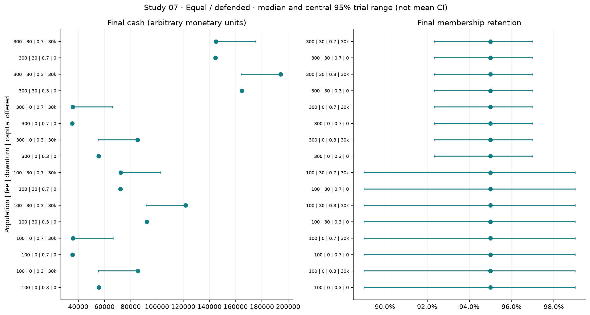

Study 07: median and central 95% trial ranges for final cash and membership retention. Labels list population, monthly fee, downturn severity and offered capital. These are distributions of outcomes, not confidence intervals for a mean.

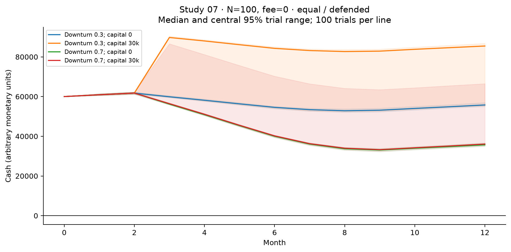

Study 07 calendar cash paths for N=100 and fee=0. Shaded bands are central 95% ranges across trials. Offering 30k does not guarantee receipt during the downturn.

## Study 07 extension: combined economic and governance stress

Important design artifact: the 100,000-contribution actor has a total financial budget of 100,000. It joins on day zero and transfers the whole budget, then cannot pay membership fees and expires on day 31, before the first election. The full event audit confirms this in all 2,400 targeted model/variant/cell trajectories across four presentation batches. These are correlated trajectories from the same 100 trial identities, not 2,400 independent trials. Synthetic personal wealth does not bypass the actor's finite operational financing budget.

Consequently, zero capture in the 100k cells cannot be attributed to the defense package: the unprotected attacker also loses eligibility before voting. The donation remains in club cash after membership expires. The 10k condition leaves fee capacity but does not reach majority capture in this grid. This extension therefore does not establish resistance to a sustained, well-funded high-contribution attack. A follow-up should budget contribution plus membership maintenance across the full horizon; the frozen results here have not been silently changed.

| Revenue-loss severity / attacker contribution | Proportional unprotected capture [95% CI] | Proportional defended capture [95% CI] | Equal defended mean cash | Equal defended survival [95% CI] |
| --- | --- | --- | --- | --- |
| Revenue loss 0.3; attacker 10000 | 0% [0.0%, 3.7%] | 0% [0.0%, 3.7%] | 66,287 | 100% [96.3%, 100.0%] |
| Revenue loss 0.7; attacker 10000 | 0% [0.0%, 3.7%] | 0% [0.0%, 3.7%] | 35,002 | 100% [96.3%, 100.0%] |
| Revenue loss 0.3; attacker 100000 | 0% [0.0%, 3.7%] | 0% [0.0%, 3.7%] | 156,169 | 100% [96.3%, 100.0%] |
| Revenue loss 0.7; attacker 100000 | 0% [0.0%, 3.7%] | 0% [0.0%, 3.7%] | 124,883 | 100% [96.3%, 100.0%] |

This extension holds downturn severity at 0.5 while varying a separate revenue-loss shock and the wealthy contribution. It retains protected outside-capital policy and layered defenses. A defense can protect voting power while leaving the club exposed to operating losses; conversely, a hostile contribution can improve cash while increasing governance concentration. Financial and governance outcomes must therefore be reported jointly.

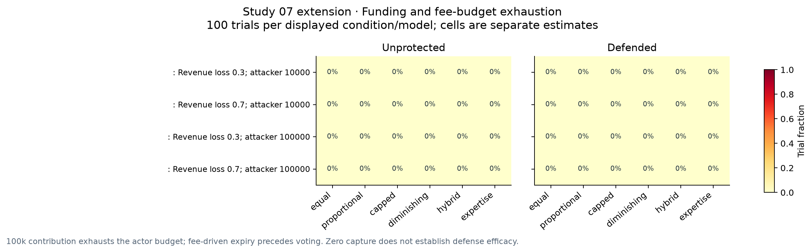

Combined-crisis extension: majority-cast capture by revenue-loss severity, attack contribution and model. Cash and survival estimates for every model/variant are in condition_results.csv.

The source-backed diagnostic is supplied as combined_crisis_diagnostic.json, with per-run counts and full event-log SHA-256 hashes. It distinguishes successful joining and subsequent fee-driven expiration from an attack rejected at admission.

## Synthesis for the fan-governance research question

| Design question | What these experiments support | What remains untested |
| --- | --- | --- |
| Broader supporter influence | Compare wealth-group power and realized turnout, not only the number of registered accounts. | Empirical willingness to join, turnout response and real supporter representativeness. |
| Funding without domination | Financial contribution and governance weight are separable policy inputs; caps/hybrid rules directly change that mapping. | Whether real contributors/investors supply funds under bounded or absent voting rights. |
| Resistance to hostile capture | Identity assurance, voting weights, entry timing and participation address different modeled mechanisms. | Adaptive attackers, multiple coordinated wealthy actors, legal enforcement and operational identity security. |
| Financial resilience | Cash buffers, fees and contingent capital offers interact with operating shocks. | Calibrated club finances, endogenous sporting policy, market valuations and long-run insolvency thresholds. |
| Blockchain support | A ledger could record policy and voting operations, but these simulations evaluate governance rules. | Transaction costs, privacy, custody, availability and whether blockchain improves any outcome versus a conventional database. |

The defensible interpretation is conditional: supporter governance needs compatible identity, weighting, participation and financing policies. There is no single tested rule that can be labeled universally optimal from these heterogeneous scenarios. A constitutional equal-vote layer with separately bounded funding-related influence is a candidate for further testing, not a conclusion about what every club should adopt.

Suggested next research: calibrate supporter wealth/contribution and participation jointly from data; elicit realistic identity error and incentive-response rates; stress budgets until failure boundaries appear; vary attacker adaptation, joining times and multi-actor coordination; measure exclusion costs; add multi-seat representative elections and legal powers; and compare a blockchain implementation with an otherwise equivalent conventional system. Target additional trials at decision-relevant boundary conditions rather than blindly pooling more heterogeneous cases.

A further causal limit is that proposal approval does not enact an endogenous management or spending policy in these presets. Voting and financial trajectories share memberships, contributions, defense costs and configured investor terms, but the engine does not establish that a particular approved proposal improves sporting results or club finances. Claims about democratic decision quality or governance-driven profitability require an additional policy-outcome model and empirical validation.

## Reproducibility, verification and limitations

The audit checks 1,368 presentation estimates with exactly 100 distinct seed/trial observations per condition/model/variant. It independently reconciles 1,801,800 economic period rows using opening cash + operating surplus + financing cash flow + investing cash flow = closing cash; observed reconciliation failures: 0. These checks establish internal consistency, not external validity.

The engine is version 0.3.5. The frozen Docker source corresponds to performance-optimized repository commit 3e5dd3675c53cfbbd295985296ed80148c1654fe; exact per-run source hashes and execution metadata are in source_manifests.json. Parallel execution partitions complete grid/trial tasks while preserving original trial identities and deterministic merge order. No scientific settings, trial counts, seeds or timeouts were changed for this campaign.

Reproduce execution with examples/run_study_campaign.py against the local running dashboard. It reuses semantically identical configurations/seeds, resumes active matching runs and writes a selected-run ledger. Analyze with examples/report_study_campaign.py, generate narrative with examples/write_study_findings.py and render with examples/publish_study_report.py in a reportlab-capable environment. The full raw dashboard volume remains the source of truth; copied summary/election/time-series tables are under results/study_campaign.

Some completed baseline event logs were archived losslessly to make room for the campaign. Their original SHA-256 digests, compressed sizes and restore commands are retained. Restore an archived log before using that run's dashboard event viewer or requesting a complete ZIP export: docker compose exec -T dashboard python /app/data/dashboard/archive_campaign_events.py restore RUN_ID. Small scientific tables remain online; no trial observations were removed.

| File | Purpose |
| --- | --- |
| condition_results.csv | All 1,368 presentation condition/model/variant estimates, pointwise binary intervals, continuous quantiles and available counts. |
| paired_defense_contrasts.csv | Matched defended-minus-unprotected differences, discordance/tie counts and conservative binary intervals. |
| pilot_results.csv | Separate 10-trial estimates; never included in the presentation sample. |
| run_provenance.csv | All 95 selected run IDs, seeds, runtimes, engine versions and summary-export checksums. |
| source_manifests.json / audit.json | Raw engine provenance and archive metadata / independently checked dataset coverage and financial identities. |
| figures/*.svg and *.png | Standalone vector and raster figures for papers/presentations. |

Limitations: all behavioral, financial and security relationships are synthetic; independence holds for distinct generated trial draws within a cell, not across matched variants/models or repeated elections; there are many unadjusted comparisons; the 100-trial design resolves large effects more reliably than rare risks; finite horizons censor later capture and insolvency; no real blockchain, club constitutional law, board transfer, strategic learning or empirical decision-quality benchmark is modeled. Conclusions concern the frozen parameter space only.

Internal research sources: docs/PHASE1_REQUEST.md (central research question); docs/PRESENTATION_STUDIES.md (frozen design and interpretation); docs/SIMULATION_ASSUMPTIONS.md (population/voting assumptions); docs/THREAT_MODEL.md (actor and defense semantics); docs/ECONOMIC_MODEL.md (cash, capital and shocks); docs/PERFORMANCE.md (deterministic optimization). This report presents newly executed campaign results, not the earlier three-trial Phase 3 demonstration figures.

Execution paused once at the initial 15 GiB physical-drive reserve after 91 completed configurations. The final four combined-crisis batches were resumed with a reassessed 12 GiB reserve after measured pilot sizes projected about 1 GiB of remaining output. This operational change did not alter scientific settings, seeds or trials. All selected run records are completed; cancelled/failed historical runs and repeated seeds are excluded.
